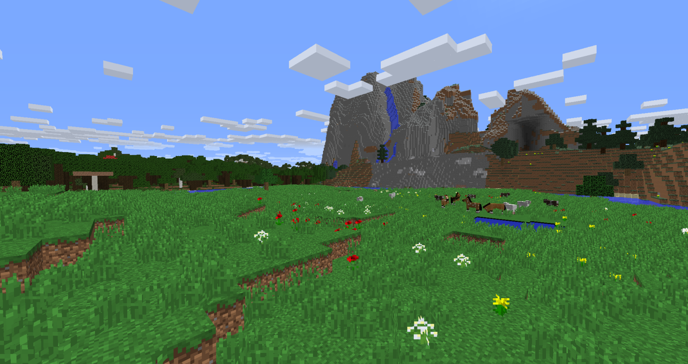
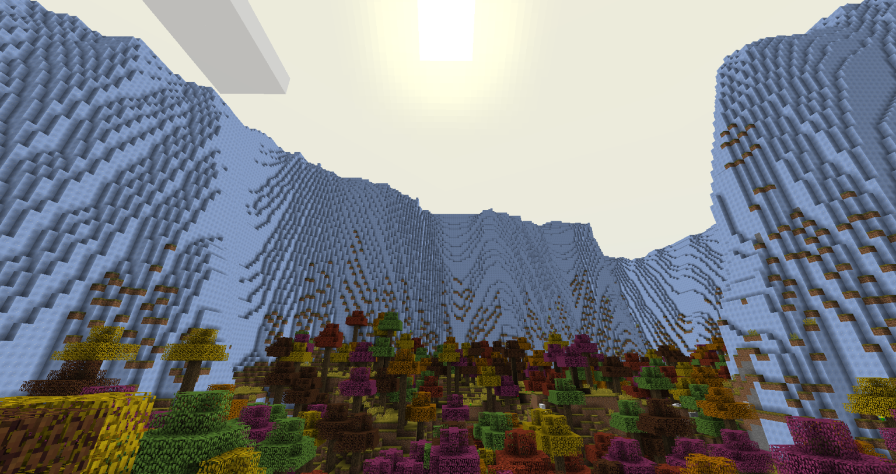
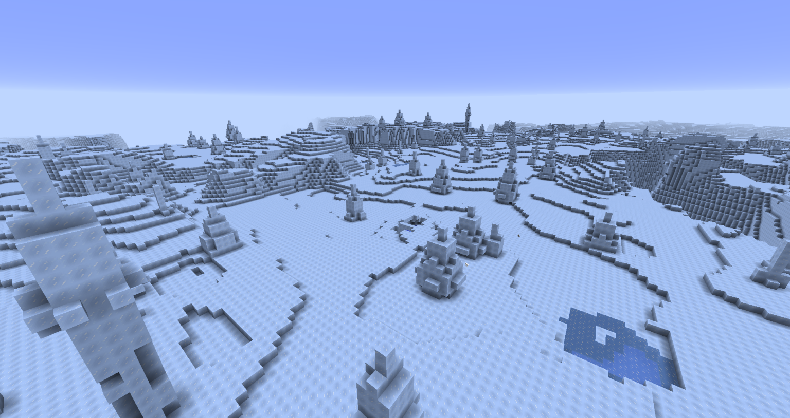
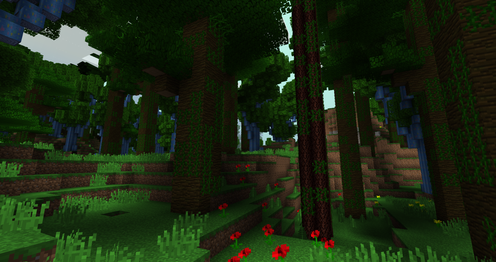
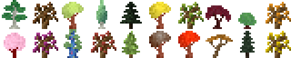
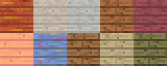

# Extra Biome Travels
Extra Biome Travels is a 1.12.2 mod focused on classic vanilla style biomes. This includes its own implementation of biomes featured in [Traverse](https://www.curseforge.com/minecraft/mc-mods/traverse-reforged) and [ExtraBiomesXL](https://www.curseforge.com/minecraft/mc-mods/extrabiomesxl)!

The mod also features its own content with additional biomes on the way to make it stand out more on its own. You can see more information about all the biomes in the mod's wiki.

#### **_IMPORTANT: This mod is going to stay on 1.12.2, there are no plans for porting from our side! The mod is currently in Beta, things are subject to change and even be removed!_**

---

### Features

#### Biomes
- **Autumnal Grove**
- **Autumnal Oak Forest**
- **Cliffs**
- **Coniferous Forest**
- **Cypress Swampland**
- **Flatlands**
- **Glacier**
- **Lush Jungle**
- **Maple Shrublands**
- **Mountainous Crag**
- **Rainforest**
- **Red Desert**
- **Red Rock Drylands**
- **Red Rock Ridge**
- **Rocky Plains**
- **Rolling Hills**
- **Snowy Coniferous Forest**
- **Thicket**
- **Wasteland**
- **Woodlands**

#### Sub-Biomes
- **Autumnal Oak Forest Hills**
- **Glacier Spikes**
- **Prairie Shrublands**
- **Wooded Red Desert**

#### Trees

- **Bald Cypress**
- **Brown Autumnal Oak**
- **Citrine Autumnal**
- **Cypress**
- **Douglas Fir**
- **Goldenrod Autumnal**
- **Green Autumnal Oak**
- **Japanese Maple**
- **Japanese Maple Shrub**
- **Orange Autumnal Oak**
- **Purple Autumnal Oak**
- **Peach Sakura**
- **Rainbow Eucalyptus**
- **Red Autumnal Oak**
- **Scalewood**
- **Umber Autumnal**
- **Vermillion Autumnal**
- **Wattle**
- **White Fir**
- **Yellow Autumnal Oak**

#### Wood

- **Autumnal**
- **Bald Cypress**
- **Cypress**
- **Douglas Fir**
- **Japanese Maple**
- **Peach Sakura**
- **Rainbow Eucalyptus**
- **Scalewood**
- **Wattle**
- **White Fir**

---

### 🙏 Special Thanks

- Originally creating [**ExtrabiomesXL**](https://www.curseforge.com/minecraft/mc-mods/extrabiomesxl) (licensed under CC BY-SA 3.0) which this mod uses assets from ~ The ExtrabiomesXL Team
- Originally creating [**Traverse 1.12.2**](https://github.com/Prospector/Traverse-Legacy-1-12-2) (licensed under MIT) which this mod uses code and assets from ~ Prospector
- All the people who helped test this mod and provided feedback

---

## Licensing

**ExtrabiomesXL Assets:** [CC BY-SA 3.0](https://creativecommons.org/licenses/by-sa/3.0/deed.en)

**Traverse 1.12.2 Code and Assets:** [MIT](https://github.com/Prospector/Traverse-Legacy-1-12-2/blob/master/LICENSE)

All code and assets specifically made for this mod are licensed as All Rights Reserved. All other assets, including those derived from Minecraft or third-party sources, remain the property of their respective owners.

You may not upload a fork or utilize the assets without permission. You are however free to include this mod in any modpacks of yours, make addons with the mod as a dependency, learn from the code, or modify it privately.

---
